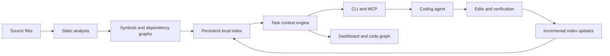

<div align="center">

<h1>CodeAtlas</h1>

<p><strong>A persistent codebase map for AI coding agents.</strong></p>

<p>Find the relevant code. Follow its dependencies. Give your agent focused context.</p>

<p>
  <a href="https://www.python.org/downloads/"></a>
  <a href="LICENSE"></a>
  <a href="docs/agents.md"></a>
  <a href="docs/architecture.md"></a>
</p>

<p>
  <a href="#quick-start">Quick start</a> &nbsp;·&nbsp;
  <a href="#dashboard-and-code-graph">Dashboard</a> &nbsp;·&nbsp;
  <a href="#agent-integrations">Integrations</a> &nbsp;·&nbsp;
  <a href="docs/README.md">Documentation</a>
</p>

</div>

## What is CodeAtlas

CodeAtlas builds a local index of your repository and turns it into useful context for a coding task. Instead of repeatedly exploring directories and opening entire files, an agent can request relevant symbols, source ranges, callers, tests, and the likely impact of a change.

The index persists between sessions and updates incrementally as files change. Access it through the CLI, connect it to an agent through MCP and hooks, or explore it yourself in the browser dashboard.

**The indexing and retrieval core runs without a language model or API key.** Your coding agent remains responsible for reasoning, editing, and executing tasks. Agent sessions use the agent provider's own authentication, network access, and usage limits.

## Capabilities

| Capability | What you can do |
| --- | --- |
| **Task context** | Turn a request into a context packet containing relevant code, exact matches, call sites, tests, and impact information within a token budget. |
| **Persistent indexing** | Keep symbols, imports, calls, and extracted project facts available across sessions; update changed files incrementally. |
| **Dependency exploration** | Follow callers and callees, inspect important symbols, and estimate which code a change may affect. |
| **Agent integration** | Expose the same context engine through CLI commands, an MCP server, hooks, and workflow skills. |
| **Local dashboard** | Manage projects, preview context, inspect repository status, and navigate a live code graph. |
| **Live comparisons** | Compare agent runs with and without CodeAtlas in separate project copies, with output, available usage metrics, and verification results. |
| **Audit workflows** | Prepare review plans, record evidence, and produce reports using your existing coding agent. |
| **Graph exports** | Export graph data as HTML, an Obsidian vault, Mermaid, DOT, GraphML, or JSON. |

## Quick start

### 1. Install from source

You need **Python 3.10 or newer** and Git to clone the repository. A Node.js installation is only needed when developing the frontend; the Python package includes built dashboard assets.

```bash
git clone https://github.com/priy-anshugupta/CodeAtlas.git
cd CodeAtlas
python -m venv .venv
```

Activate the environment:

```powershell
# Windows PowerShell
.\.venv\Scripts\Activate.ps1
```

```bash
# macOS / Linux
source .venv/bin/activate
```

Install CodeAtlas, including the optional JavaScript, TypeScript, Go, and Java parsers:

```bash
python -m pip install -e ".[treesitter]"
codeatlas --version
```

For a minimal installation, use `python -m pip install -e .`. Python parsing is included. Optional parser and embedding extras are listed in [pyproject.toml](pyproject.toml).

### 2. Enable a repository

Change to the project you want to index, then run:

```bash
cd /path/to/your-project
codeatlas init
codeatlas status
```

The interactive setup previews its changes and asks for confirmation. It can create `.aicontext/`, record your local consent, install selected agent integrations, and run the first scan. If you skip that scan, run `codeatlas scan` when ready.

### 3. Retrieve context and open the dashboard

```bash
codeatlas task "Find where discount rules are applied and which tests cover them"
codeatlas search "discount coupon"
codeatlas view
```

Open the **complete local URL printed by `codeatlas view`**. It includes the authentication information needed to access the dashboard.

For symbol-level exploration, replace the example below with a symbol from your own project:

```bash
codeatlas context shop.pricing.discounts.apply_discount
codeatlas impact shop.pricing.discounts.apply_discount
```

See the [getting started guide](docs/getting-started.md) for setup options and example output.

## How it works



CodeAtlas discovers files, parses supported languages, builds symbol and dependency graphs, and extracts facts such as routes, models, configuration, and test relationships. It stores readable JSON and Markdown artifacts in `.aicontext/`, with disposable caches for queries.

Task retrieval combines literal matches, ranked search, and graph relationships. The agent gets a bounded working set rather than an unrestricted dump of the repository. Queries check index freshness, and supported hooks can refresh it after edits.

Read the [architecture guide](docs/architecture.md) and [context engine guide](docs/context-engine.md) for implementation details.

## Dashboard and code graph

Run `codeatlas view` from an indexed repository to open the workspace.

| View | Purpose |
| --- | --- |
| **Projects** | Add a local folder or download a Git repository, index it, and select the active project. |
| **Repository** | Check the source branch, index coverage, freshness, and repository status. |
| **Context** | Preview task context as readable text or JSON before using it with an agent. |
| **Graph** | Explore packages, files, and symbols; inspect relationships and switch between network and layer layouts. |
| **Live** | Run a paired comparison and follow agent activity, terminal output, timers, and available token counts. |
| **Compare and Runs** | Inspect recorded results, verification outcomes, and exported evidence. |
| **Settings** | Inspect agent executable detection and integration capabilities. |

Live comparisons support panels for **up to three projects**. Each paired run uses separate source copies, with CodeAtlas enabled in one copy. The dashboard exposes verification results alongside usage so that a lower token count is not mistaken for a successful solution.

Agent executables and authentication must be available locally. Usage fields and execution capabilities differ by agent; unavailable metrics should not be treated as zero. Agent runs may consume your provider quota.

See [dashboard setup and comparison workflows](docs/dashboard.md) for requirements, sandbox behaviour, and measurement details.

## Agent integrations

CodeAtlas includes integrations for **Claude Code, Codex, Cursor, Gemini CLI, and Antigravity**. The supported delivery mechanism varies by host.

- **CLI:** retrieve context directly with `codeatlas task`, `search`, `context`, and `impact`.
- **MCP:** expose context tools to compatible coding agents through `codeatlas mcp`.
- **Hooks:** supply context or update the index automatically where the host supports the configured hook.
- **Skills:** provide workflows for context retrieval, project refresh, audits, and recorded decisions.

Choose an integration during `codeatlas init`. See [agent configuration](docs/agents.md) for host-specific setup and limitations. A configured integration should be checked for successful delivery before its results are compared.

## Command reference

| Workflow | Commands |
| --- | --- |
| Setup and diagnostics | `init`, `enable`, `disable`, `pause`, `resume`, `doctor` |
| Index maintenance | `scan`, `update`, `status`, `watch`, `migrate` |
| Code navigation | `task`, `brief`, `search`, `locate`, `context`, `impact`, `module`, `trace` |
| Project knowledge | `refresh`, `decision`, `note`, `recall` |
| Code review | `audit plan`, `audit record`, `audit update`, `audit report` |
| Visualization | `view`, `graph export` |
| Agent interfaces | `mcp`, `hook` |

Run `codeatlas --help` or consult the [full CLI reference](docs/cli.md).

## Evaluation and limitations

The repository includes a repeatable [orientation-token harness](tests/benchmarks/tokens.py), retrieval evaluations, and live-run measurement tools.

The recorded offline harness results include:

| Evaluation subject | Without context layer | With context layer | Change in estimated orientation tokens |
| --- | ---: | ---: | ---: |
| Django and React application, 305 files, 12 tasks | 356,657 | 28,202 | 92% fewer |
| Tool source snapshot, 140 files, 10 tasks | 105,846 | 28,981 | 73% fewer |
| Small fixture, 12 files | 1,115 | 3,136 | 181% more |

These are **recorded harness results**, not a fresh benchmark of this renamed release or a guarantee for your repository. The offline counts estimate orientation context; they do not establish provider billing, task correctness, or end-to-end speed. Small repositories can incur more overhead than they save.

For a useful live comparison, keep the task, source snapshot, agent configuration, and verification criteria comparable. Check successful context delivery and task completion before interpreting a token difference. See [benchmark methodology](docs/benchmarks.md).

## Development

From the CodeAtlas checkout, with your virtual environment activated:

```bash
python -m pip install -e ".[dev,treesitter]"
python -m pytest
python -m ruff check .
python -m mypy codeatlas
```

To develop the frontend, use the Node.js version specified in the [contributing guide](CONTRIBUTING.md):

```bash
cd viewer
npm ci
npm run build
npm test
```

The frontend build writes the packaged assets to `codeatlas/viewer_dist/`. Changes to frontend source should include the rebuilt assets.

## Documentation

| Guide | Covers |
| --- | --- |
| [Getting started](docs/getting-started.md) | Installation, consent, first index, and everyday use |
| [Architecture](docs/architecture.md) | Parsing, graphs, indexing, and incremental updates |
| [Context engine](docs/context-engine.md) | Retrieval, bounded packets, and persistent knowledge |
| [Agent integrations](docs/agents.md) | MCP, hooks, skills, and supported hosts |
| [Dashboard](docs/dashboard.md) | Projects, live comparisons, and recorded output |
| [Graph viewer](docs/viewer.md) | Graph exploration, keyboard controls, and exports |
| [Configuration](docs/configuration.md) | Project settings and environment variables |
| [Index artifacts](docs/aicontext.md) | The `.aicontext/` layout and schemas |
| [Auditing](docs/audit.md) | Review plans, evidence, and findings |
| [Benchmarks](docs/benchmarks.md) | Evaluation design and measurement caveats |
| [Troubleshooting](docs/troubleshooting.md) | Diagnostics and common setup issues |

## Contributing

Read [CONTRIBUTING.md](CONTRIBUTING.md) before opening a pull request. Include the checks relevant to your change and keep source changes separate from generated files where practical. Please follow the [Code of Conduct](CODE_OF_CONDUCT.md) and use the [security policy](SECURITY.md) for vulnerability reports.

## License

CodeAtlas is distributed under the [MIT license](LICENSE).
