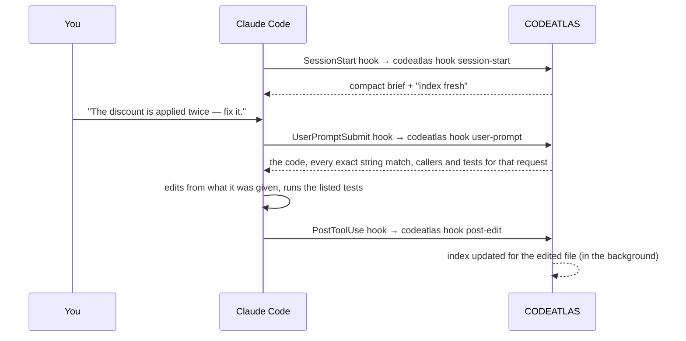

# Getting started

This guide takes you from installation to a working agent session with CODEATLAS in about five
minutes.

- [1. Install](#1-install)
- [2. Enable CODEATLAS in a repository](#2-enable-codeatlas-in-a-repository)
- [3. Look around](#3-look-around)
- [4. Work with your agent](#4-work-with-your-agent)
- [5. Keep it healthy](#5-keep-it-healthy)
- [Sharing with a team](#sharing-with-a-team)
- [Removing CODEATLAS](#removing-codeatlas)

## 1. Install

CODEATLAS needs Python 3.10 or newer. Git is optional but recommended: it adds churn, ownership and
co-change information.

```bash
pip install -e .
codeatlas --version
```

Optional extras:

| Extra | Adds |
|---|---|
| `codeatlas-ctx[treesitter]` | Parsing for JavaScript, TypeScript, Go and Java (Python is always supported) |
| `codeatlas-ctx[semantic]` | Local embeddings for `codeatlas search --semantic` (the model must already be on disk; CODEATLAS never downloads) |

Installing CODEATLAS does nothing to any repository. It only runs where you enable it.

## 2. Enable CODEATLAS in a repository

```bash
cd your-repo
codeatlas init
```

`codeatlas init` is interactive. It detects your agent, asks about the optional parts, then shows
every file it will create or modify and asks once more before touching anything. With hooks and
the MCP server declined, a Claude Code repository looks like this:

```text
Install agent hooks (session brief + index update after edits)? [Y/n]: n
Register the CODEATLAS MCP server for your agent? [Y/n]: n
CODEATLAS will make these changes in /home/you/your-repo:
  create   .aicontext/manifest.json  (new CODEATLAS index directory)
  modify   .gitignore  (add .aicontext/cache/, .aicontext/audit/scratch/)
  register ~/.config/codeatlas/repos.toml  (enable CODEATLAS for you in this repo (local only))
  create   .claude/skills/codeatlas-context/SKILL.md  (codeatlas-context skill)
  create   .claude/skills/codeatlas-refresh/SKILL.md  (codeatlas-refresh skill)
  create   .claude/skills/codeatlas-audit/SKILL.md  (codeatlas-audit skill)
  create   .claude/skills/codeatlas-decisions/SKILL.md  (codeatlas-decisions skill)
  create   CLAUDE.md  (short CODEATLAS instruction block)
Proceed? [Y/n]:
```

Accepting hooks adds entries to `.claude/settings.json`; accepting the MCP server adds a `codeatlas`
entry to `.mcp.json`. At the end, `init` offers to run the first scan.

Useful options:

| Option | Effect |
|---|---|
| `--agent claude-code\|cursor\|codex\|gemini\|antigravity\|generic\|none` | Choose the integration instead of auto-detecting |
| `--no-hooks` / `--no-mcp` / `--no-git-hooks` | Skip parts of the setup |
| `--yes` | Accept the defaults (for scripts) |
| `--scan` / `--no-scan` | Decide about the first scan up front |

The first scan of a 50,000-line repository takes a few seconds.

## 3. Look around

```bash
codeatlas status                      # enabled? fresh? any stale brief sections?
codeatlas brief                       # the compact session brief your agent receives
codeatlas task "discount applied twice"   # what one call returns for a request
codeatlas search "discount coupon"    # ranked hits with file:line
codeatlas context shop.pricing.discounts.apply_discount
codeatlas impact shop.pricing.discounts.apply_discount
codeatlas view                        # the interactive graph in your browser
```

On the `small` fixture repository in `tests/fixtures/repos/`, search and a context pack look like
this (Markdown is the default; add `--json` for tools):

```text
$ codeatlas search "discount coupon" --limit 4
# search "discount coupon"
- function `shop.pricing.discounts.apply_discount` src/shop/pricing/discounts.py:8-14 — Apply the best eligible discount to an amount.
- method `shop.checkout.cart.Cart.total` src/shop/checkout/cart.py:29-31 — Subtotal with the best discount applied.
- module `shop.pricing.discounts` src/shop/pricing/discounts.py — Applying discounts to carts.
- class `shop.pricing.rules.Rule` src/shop/pricing/rules.py:8-16 — A percentage discount with a minimum spend.

$ codeatlas context shop.pricing.discounts.apply_discount
# Context: `shop.pricing.discounts.apply_discount`
function `apply_discount(amount: Money, rules: list['rules_mod.Rule'], coupon: float | None = None) -> Money` — src/shop/pricing/discounts.py:8-14
Apply the best eligible discount to an amount.
Risk 0.14

## Read list (252/2000 tokens)
1. src/shop/pricing/discounts.py:8-14 — target (~89 tok)
2. src/shop/checkout/cart.py:29-31 — caller `shop.checkout.cart.Cart.total` (~45 tok)
3. src/shop/pricing/rules.py:19-21 — callee `shop.pricing.rules.eligible_rules` (~41 tok)
4. tests/test_discounts.py:6-8 — test `tests.test_discounts.test_best_rule_wins` (~38 tok)
5. src/shop/money.py:15-17 — callee `shop.money.Money.scale` (~39 tok)

## Callers
- `shop.checkout.cart.Cart.total` src/shop/checkout/cart.py:31
…
## Blast radius: 8 files
…
```

The agent reads the five ranges in the read list (about 250 tokens) instead of the files around
them.

## 4. Work with your agent

With the Claude Code integration installed, you don't need to do anything differently:



The prompt hook adds nothing for greetings, confirmations and slash commands, and only what it
is reasonably sure of for everything else, so most of the benefit is the answer already being
there when the agent starts: no search, no extra turns. Agents without that hook (or without
hooks at all) call `codeatlas task` themselves; the instruction block CODEATLAS adds says how.

You never have to tell CODEATLAS about an edit: every answer first checks the working tree and brings
changed files up to date. `codeatlas watch` and the git hooks remain for people who want the index
current between questions.

Things to ask your agent:

- *"Refresh the CODEATLAS brief."* runs the `codeatlas-refresh` skill and writes the narrative sections
  of `AGENTS.md` (purpose, architecture, conventions). This is optional: research on coding
  agents finds that generated project overviews raise cost without helping agents find files
  faster, so CODEATLAS does not need them. Write them if you have conventions worth stating; once
  written they are included in the session brief.
- *"Audit the codebase"* or *"check before I merge"* runs the `codeatlas-audit` skill. See
  [audit.md](audit.md).
- *"Record the decision to …"* runs the `codeatlas-decisions` skill.

## 5. Keep it healthy

| Situation | What to do |
|---|---|
| You pulled or switched branches | Nothing with hooks (session start catches up), otherwise `codeatlas update` |
| `codeatlas status` reports stale sections (only if you wrote narrative sections) | Ask the agent to refresh the brief |
| You upgraded CODEATLAS and the schema changed | `codeatlas migrate` |
| Something looks wrong | `codeatlas doctor` (see [troubleshooting.md](troubleshooting.md)) |
| You want a break | `codeatlas pause`, later `codeatlas resume` |

## Sharing with a team

`.aicontext/` is designed to be committed, so every teammate and every AI session benefits from
one scan (`cache/` and `audit/scratch/` stay ignored). Committed files never switch CODEATLAS on for
anyone else: each teammate who wants it runs `codeatlas enable` once. Until then their hooks print a
single line saying CODEATLAS is available and do nothing else.

## Removing CODEATLAS

```bash
codeatlas uninstall-integration          # remove skills, hooks, MCP entry and managed blocks (restores backups)
codeatlas uninstall-integration --purge  # also delete .aicontext/ and your consent flag
pip uninstall codeatlas-ctx
```
